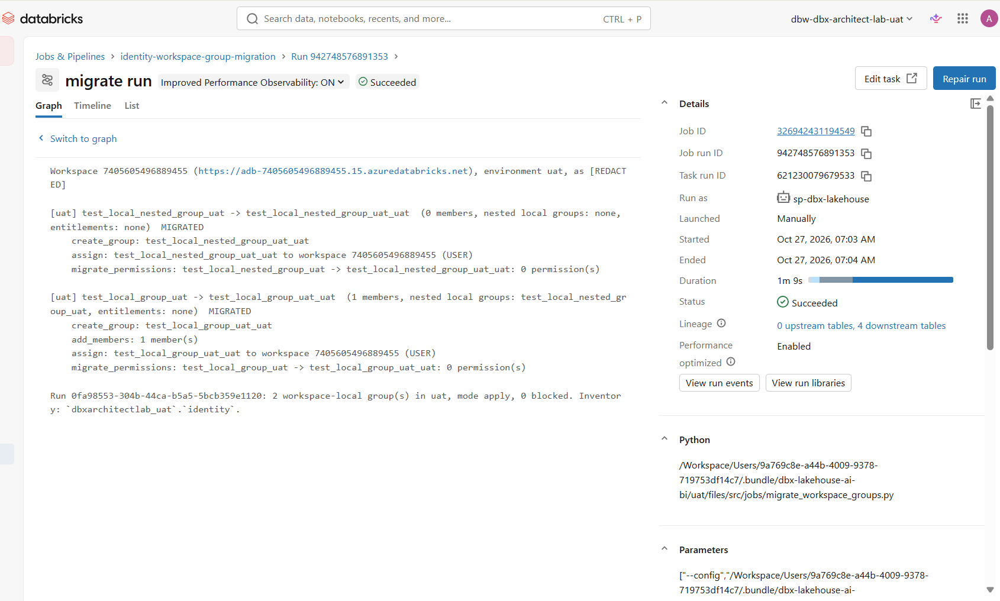

# Identity: workspace-local groups to account groups

Part of [dbx-lakehouse-ai-bi](README.md): how the bundle migrates the workspace-local groups of dev, uat and
prod to account groups. The repository's structure, environments, setup and deployment are in the
[README](README.md); this guide assumes that setup is done.

Workspace-local groups live in one workspace only. Unity Catalog can't grant to them, the account can't see or
audit them, and the same name can mean different people in dev and prod. Account groups fix all three: one
definition, assigned to the workspaces that need it, usable in Unity Catalog grants.

The `identity-workspace-group-migration` job is deployed to dev, uat and prod like every other job here, and each
copy migrates **the workspace it runs in**. That keeps every workspace call inside its own workspace: serverless
compute can't call another workspace's API unless the account's network policy allows cross-workspace access. For
each workspace-local group, it:

1. **Account group:** creates one, named by `naming.template` in `config/group_migration.yaml` (default
   `{group}_{env}`, the environment from the bundle target). It only reuses an account group that it created itself
   in an earlier run (the registry table), or that the config lists in `adopt_account_groups`.
2. **Members:** the same users (by userName), service principals (by applicationId) and nested groups. Nested
   workspace-local groups are migrated first, and their account groups are added instead; if a nested group is
   blocked, every group that contains it is blocked too.
3. **Name clash:** if the account group has the local group's own name, the local group is renamed to
   `db-temp-<name>` first.
4. **Workspace access:** assigns the account group to the workspace (USER) and copies the local group's
   entitlements.
5. **Permissions:** moves the local group's permissions on workspace objects (clusters, jobs, notebooks, folders,
   SQL warehouses, ...) to the account group with the permission migration API.
6. **Clean-up:** deletes the local group, only in a run with `delete_local_groups = true`.

Every step is idempotent, so a failed run can be repeated. Problems (an identity missing at the account, a nested
group cycle or a blocked nested group, an account group that exists but wasn't created by the migration) are
reported, and that group is skipped in apply mode.

| File | What it is |
| --- | --- |
| `src/identity/group_migration.py` | The migration: inventory, naming, conflicts, nested-group order, the steps above |
| `src/identity/inventory.py` | The inventory tables |
| `src/jobs/migrate_workspace_groups.py` | The job entry point |
| `config/group_migration.yaml` | Naming, exclusions, adoptions, where the account credentials are |
| `resources/identity_group_migration.job.yml` | The migration job (on demand) |
| `resources/identity_local_group_drift.job.yml` | The daily drift check |

## One account group per workspace, never shared

Account groups are account-wide. If dev's, uat's and prod's `data_engineers` became one account group, everyone in
dev's group would gain prod's permissions. So the naming template **must** contain `{env}`: the same local group name
in three workspaces always becomes three account groups (`data_engineers_dev`, `data_engineers_uat`,
`data_engineers_prod`). The job refuses to start with a template that lacks `{group}` or `{env}`.

## Inventory tables

Every run (plan and apply) appends to four Delta tables in the environment's own catalog, schema `identity`
(`dbxarchitectlab_dev.identity`, `dbxarchitectlab_uat.identity`, `dbxarchitectlab_prod.identity`; created on the
first run):

| Table | One row per | Use it for |
| --- | --- | --- |
| `local_groups` | local group per run | The inventory: account group, member count, nested local groups, entitlements, status (`planned`, `migrated`, `local_group_deleted`, `blocked`), problems |
| `local_group_members` | member per local group per run | Who was in each local group when it was migrated |
| `migration_actions` | step per group per run | The audit trail: what was planned or done, in order |
| `account_group_registry` | account group the migration created | Which account groups the migration owns and may reuse |

Apply needs these tables (it reads the registry), so run it as the Databricks job.

## Set up the migration (once)

The job runs as `sp-dbx-lakehouse`. Creating account groups and assigning them to workspaces are account
operations, and moving permissions and changing groups are workspace-admin operations, so for this job
`sp-dbx-lakehouse` needs more than the deployment does:

1. **Account admin:** account console → **User management → Service principals → `sp-dbx-lakehouse` → Roles** →
   **Account admin**. Anyone who can change this repository's jobs (and deploy a branch to dev) can then act with
   account-admin rights through it: keep the repository's write access and the `prod` reviewers to the platform team.
2. **Workspace admin in dev, uat and prod:** in `dbx-platform-infra-azure`, add its application ID to
   `live/<env>/workspace-bootstrap/workspace-admin-config.yaml` for dev, uat and prod, then plan and apply each
   `<env>-dbxarchitectlab-workspace-bootstrap`.
3. **Its account credentials, in each of dev, uat and prod:** the account API can't use the job's own identity, so
   the job signs in to the account with `sp-dbx-lakehouse`'s client ID and OAuth secret and the account ID, all three
   read from the workspace's `sct_dbx_architect_lab` scope (`sp-dbx-lakehouse-client-id`,
   `sp-dbx-lakehouse-client-secret`, `databricks-account-id`). As a workspace admin of dev, uat and prod, in Git Bash:

   ```bash
   bash scripts/put-migration-secrets.sh
   ```

   It asks for the account ID and the OAuth secret once (hidden), signs in to each workspace in the browser, stores
   the three secrets, gives `sp-dbx-lakehouse` READ on the scope and lists the keys. Paste each value on its own;
   pasting several lines at once into the prompt goes wrong.

   Use the same Databricks OAuth secret as the GitHub environments ([one-time setup](README.md#one-time-setup) step 1), and rotate it in both
   places (see [Maintenance](README.md#maintenance)).
4. **Catalog:** nothing to do. `sp-dbx-lakehouse` already has `CREATE SCHEMA` on each environment's catalog ([one-time
   setup](README.md#one-time-setup) step 3) and creates the `identity` schema on the first run.
5. Deploy (merge to `main`, or **Run workflow** for dev): the two jobs appear in each workspace.

The drift check's schedule is paused (`pause_status: PAUSED` in `resources/identity_local_group_drift.job.yml`): it
fails every day while local groups exist. Set it to `UNPAUSED` once the migration is finished.

## Run it

In each workspace, run `identity-workspace-group-migration` (**Run now with different parameters**):

| Run | Where | `mode` | `delete_local_groups` |
| --- | --- | --- | --- |
| 1. Review what would change | dev, uat, prod | `plan` | `false` |
| 2. Migrate dev | dev | `apply` | `false` |
| 3. Check dev: users still reach their jobs, clusters, notebooks and warehouses | | | |
| 4. Migrate uat, then prod | uat, then prod | `apply` | `false` |
| 5. Remove the local groups, once checked | dev, then uat, prod | `apply` | `true` |

Plan mode changes nothing in the workspace or the account. The output lists every local group, its account group,
its nested local groups and each action (`WOULD ...`), plus any problem to fix first; the same goes into the
inventory tables. Test groups: `src/notebooks/shared/create_workspace_level_group` ([shared notebooks](README.md#shared-notebooks)) creates `test_local_group_<env>`
with the nested group `test_local_nested_group_<env>` in it; plan lists the nested group under the parent's nested
local groups and migrates it first.

## Test evidence

### Nested group migration in uat (apply), 2026-10-27

`identity-workspace-group-migration` in uat, `mode` = `apply`, `delete_local_groups` = `false`, run as
`sp-dbx-lakehouse` (job run 942748576891353): **Succeeded**, 2 workspace-local groups migrated, 0 blocked. The test
groups came from `create_workspace_level_group`.



| Workspace-local group | Account group | Steps | Result |
| --- | --- | --- | --- |
| `test_local_nested_group_uat` (no members, no nested groups) | `test_local_nested_group_uat_uat` | `create_group`, `assign` to the uat workspace (USER), `migrate_permissions` (0) | MIGRATED, first |
| `test_local_group_uat` (1 member: the nested group) | `test_local_group_uat_uat` | `create_group`, `add_members` (1: the nested group's account group), `assign` (USER), `migrate_permissions` (0) | MIGRATED, after the nested group |

What it shows:

- **Nested-group order:** the nested group was migrated first, so its account group existed when the parent's
  account group needed it as a member.
- **Nesting kept:** `test_local_group_uat_uat` has `test_local_nested_group_uat_uat` as its member, as the local
  groups had.
- **Naming:** `{group}_{env}` gives `<local name>_uat`. The test groups already end in `_uat`, so the names repeat it.
- **Per-environment run:** the job ran inside uat, as `sp-dbx-lakehouse`, and recorded the run in
  `dbxarchitectlab_uat.identity`.

## What it doesn't cover

- **Unity Catalog grants:** none to migrate, since Unity Catalog never accepted workspace-local groups. Grant the new
  account groups where needed.
- **Legacy Hive metastore table ACLs:** check them separately if the workspaces used table access control.
- **Who should be in a group:** the job copies membership as it is. Review it before prod.

## Keeping it that way

`identity-local-group-drift-check`, once unpaused, runs daily in uat and prod (paused in dev) in plan mode and fails, with an email,
when any workspace-local group exists. Longer term, make Microsoft Entra ID the source of account groups (SCIM
provisioning or automatic identity management), so groups are managed once, in Entra ID, and only assigned to
workspaces.
